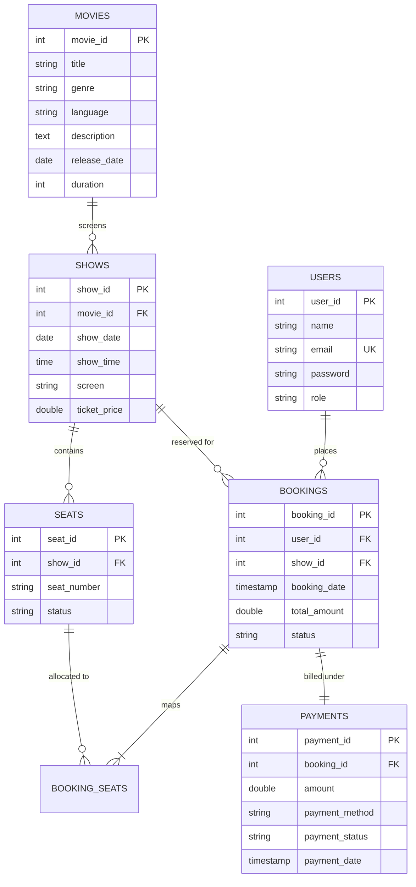

# 🎬 Online Movie Ticket Booking System

[](https://www.oracle.com/java/)
[](https://docs.oracle.com/javase/tutorial/uiswing/)
[](https://www.mysql.com/)
[](https://dev.mysql.com/downloads/connector/j/)
[](#-object-oriented-design--architecture)

A desktop-based **Online Movie Ticket Booking System** built using **Java (Swing)** and **MySQL via JDBC**. Designed around core **Object-Oriented Programming (OOP)** principles and robust transactional database operations, this application delivers a seamless experience for customers to browse movies, pick showtimes, select real-time seats, and book tickets, while offering an administrative suite for managing catalog, scheduling, and user accounts.

---

## 📌 Table of Contents
- ✨ [Key Features](#-key-features)
  - [Customer Portal](#customer-portal)
  - [Admin Portal](#admin-portal)
- 🏛 [Object-Oriented Design & Architecture](#-object-oriented-design--architecture)
- 📂 [Project Structure](#-project-structure)
- 🗄 [Database Schema & Setup](#-database-schema--setup)
- 🚀 [Quickstart & Installation](#-quickstart--installation)
- 🔐 [Demo Credentials](#-demo-credentials)
- 👥 [Project Team & Responsibilities](#-project-team--responsibilities)

---

## ✨ Key Features

### Customer Portal
* **User Authentication**: Secure customer account registration and login with input validation and session management.
* **Browse & Search Catalog**: Interactive movie catalog with title-based keyword filtering and detailed metadata (genre, language, runtime, synopsis).
* **Showtime Schedule**: View scheduled dates, screening halls, and pricing per movie.
* **Interactive Seat Grid**:
  * Real-time seat status visualization (🟢 Available, 🟠 Selected, 🔴 Booked).
  * 100-seat theater arrangement (Rows A–J, Seats 1–10).
  * Auto-detection for sold-out screenings (**HOUSEFULL** indicator).
* **Polymorphic Payments**:
  * Unified checkout supporting **UPI** (virtual payment addresses) and **Card** (credit/debit with card masking).
* **Booking History & Self-Cancellation**:
  * Complete audit trail with timestamps, total price, and allocated seat numbers.
  * Instant ticket cancellation with automatic seat release and status update.

### Admin Portal
* **Movie Management (CRUD)**: Add, edit, inspect, and delete movies with cascade updates.
* **Show Scheduling**: Schedule shows with specific dates, times, screens, and custom ticket pricing with automated 100-seat layout generation.
* **Centralized Booking Ledger**: View all customer reservations, seat allocations, payment amounts, and transaction statuses across the platform.
* **User Administration**: View registered customers, ban fraudulent users, and safely remove accounts with active booking dependency protection.

---

## 🏛 Object-Oriented Design & Architecture

The application strictly adheres to modular software design and the 4 pillars of OOP:

| Principle | Implementation Details |
| :--- | :--- |
| **Encapsulation** | All entities (`Movie`, `Show`, `Seat`, `Booking`, `User`) protect internal state using `private` fields with strictly controlled public accessors and mutators. |
| **Inheritance** | Base class `User` encapsulates shared authentication logic and fields, extended by concrete `Customer` and `Admin` subclasses (`IS-A` relationship). |
| **Polymorphism** | The `Payment` interface defines `makePayment(double amount)` and `getMethodName()`. `PaymentFrame` handles payments polymorphically using either `UPIPayment` or `CardPayment` at runtime. |
| **Abstraction** | Clear layer separation between UI Presentation (`*Frame`), Data Access Objects (`*DAO`), Business Domain Models, and Database Connectivity (`DBConnection`, `Config`). |
| **ACID Transactions** | Critical workflows (e.g. ticket booking, seat reservation, payment registration) run under atomic transactions with `SELECT ... FOR UPDATE` row-level locks, batch updates, and automated rollback upon collision. |

---

## 📂 Project Structure

```text
OnlineMovieBooking/
│
├── .env.example              # Template for local MySQL credentials
├── compile.ps1               # Automated build script (PowerShell)
├── run.ps1                   # Application execution script (PowerShell)
│
├── lib/
│   └── mysql-connector-j-26.7.0.jar  # JDBC MySQL Driver
│
├── sql/
│   └── movie_booking.sql     # Database schema, table definitions, & sample data
│
└── src/
    ├── admin/                # Administrator UI Frames
    │   ├── AdminDashboard.java
    │   ├── ManageBookingsFrame.java
    │   ├── ManageMoviesFrame.java
    │   ├── ManageShowsFrame.java
    │   └── ManageUsersFrame.java
    │
    ├── auth/                 # Authentication & Registration
    │   ├── LoginFrame.java
    │   ├── RegisterFrame.java
    │   └── UserDAO.java
    │
    ├── booking/              # Seat selection & Booking transactions
    │   ├── BookingDAO.java
    │   ├── SeatDAO.java
    │   └── SeatSelectionFrame.java
    │
    ├── customer/             # Customer UI Frames
    │   ├── BookingHistoryFrame.java
    │   ├── CustomerDashboard.java
    │   └── ProfileFrame.java
    │
    ├── database/             # Connection pooling & .env reader
    │   ├── Config.java
    │   └── DBConnection.java
    │
    ├── main/                 # Application Entry Point
    │   └── Main.java
    │
    ├── model/                # Domain Entities (OOP Models)
    │   ├── Admin.java
    │   ├── Booking.java
    │   ├── Customer.java
    │   ├── Movie.java
    │   ├── Seat.java
    │   ├── Show.java
    │   └── User.java
    │
    ├── movies/               # Movie browsing & catalog DAO
    │   ├── MovieDAO.java
    │   └── MovieFrame.java
    │
    ├── payment/              # Polymorphic Payment Subsystem
    │   ├── CardPayment.java
    │   ├── Payment.java
    │   ├── PaymentDAO.java
    │   ├── PaymentFrame.java
    │   └── UPIPayment.java
    │
    └── shows/                # Show scheduling & listings
        ├── ShowDAO.java
        └── ShowFrame.java
```

---

## 🗄 Database Schema & Setup

The database utilizes relational integrity with foreign keys, cascade rules, and automated timestamping.



### Initializing MySQL Database:
1. Open MySQL Workbench or command line client.
2. Execute the setup script:
   ```sql
   SOURCE sql/movie_booking.sql;
   ```

---

## 🚀 Quickstart & Installation

### 1. Prerequisites
- **Java JDK 17+** installed and added to `PATH`.
- **MySQL Server 8.0+** running locally.

### 2. Configure Environment (`.env`)
Copy `.env.example` to `.env` in the project root:
```properties
DB_URL=jdbc:mysql://localhost:3306/movie_booking
DB_USER=root
DB_PASSWORD=your_mysql_password
```
> ⚠️ **Note**: `.env` is ignored by git to keep your local credentials private.

### 3. Compile Project
Run the automated PowerShell compile script:
```powershell
.\compile.ps1
```
*(This builds all `.java` files from `src/` into the `bin/` directory with the connector library on the classpath).*

### 4. Run Application
Launch the graphical interface:
```powershell
.\run.ps1
```
Or run directly via standard Java CLI:
```bash
java -cp "lib/mysql-connector-j-26.7.0.jar;bin" main.Main
```

---

## 🔐 Demo Credentials

The database script pre-seeds standard test accounts:

| Portal | Email Address | Password | Role |
| :--- | :--- | :--- | :--- |
| **Administrator** | `admin@example.com` *(or `admin@moviebooking.com`)* | `admin123` | `Admin` |
| **Customer** | `aaron@example.com` | `pass123` | `Customer` |
| **New Customer** | *Any registered account via UI* | *(Custom)* | `Customer` |

---

## 👥 Project Team & Responsibilities

| Roll Number | Team Member | Primary Modules & Responsibilities |
| :--- | :--- | :--- |
| **VAS25CS001** | **Aaron Thalakkottor Sooraj** | **Database Architecture & Integration**<br>• MySQL database schema design & setup (`sql/`)<br>• JDBC connection pooling & transaction handling (`database/`)<br>• Environment configuration & build management |
| **VAS25CS012** | **Abinandh P S** | **Movie & Show Management**<br>• Catalog presentation & search filtering (`movies/`)<br>• Showtime scheduling & hall mapping (`shows/`)<br>• Movie & Show DAOs and Admin interfaces |
| **VAS25CS017** | **Adhin Seby** | **Seat Booking & Payment Processing**<br>• Real-time theater seat grid UI & state machine (`booking/`)<br>• Polymorphic payment interface & integrations (`payment/`)<br>• Booking transaction coordination & validation |
| **VAS25CS026** | **Adwaith S Kumar** | **User Authentication & Domain Modeling**<br>• OOP inheritance hierarchy (`User`, `Customer`, `Admin`)<br>• User login, registration & session validation (`auth/`)<br>• User management & account authorization controls |

---

<p align="center">
  <b>Built for Academic Submission • Object-Oriented Programming & Database Systems</b>
</p>

📄 Credits & License

---
### 📄 Credits & License

* **Project:** Online Movie Ticket Booking System
* **Developed by:** Group-03 (Aaron Thalakkottor Sooraj, Abinandh P. S., Adhin Seby, Adwaith S. Kumar)

© 2023 ATS_PDZ. All rights reserved.  
*This project was created for educational and academic purposes.*
