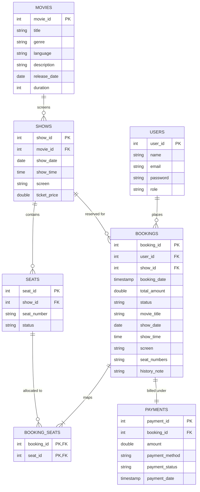

# 🗄 Documentation & Architecture

[← Back to Main README](../README.md)

This directory contains the system architecture specification, Entity-Relationship (ER) diagram, relational integrity rules, data dictionary, and presentation slides for the **Online Movie Ticket Booking System**.

> 📽️ **Project Presentation Slide Deck:**  
> **[OOPS PROJECT - Presentation.pptx](OOPS%20PROJECT%20-%20Presentation.pptx)** *(1.5 MB PowerPoint Presentation)*

---

## 📌 Table of Contents
- [Project Presentation](#-project-presentation)
- [Entity-Relationship (ER) Diagram](#-entity-relationship-er-diagram)
- [Relational Structure Map](#-relational-structure-map)
- [Data Dictionary & Tables](#-data-dictionary--tables)
  - [1. Users Table](#1-users-table)
  - [2. Movies Table](#2-movies-table)
  - [3. Shows Table](#3-shows-table)
  - [4. Seats Table](#4-seats-table)
  - [5. Bookings Table](#5-bookings-table)
  - [6. BookingSeats Table (Junction)](#6-bookingseats-table-junction)
  - [7. Payments Table](#7-payments-table)
- [Integrity & Cascade Rules](#-integrity--cascade-rules)
- [Database Setup & Verification](#-database-setup--verification)

---

## 📽️ Project Presentation

The project presentation slide deck prepared for academic review and viva examinations is stored directly in this directory:

* 📥 **[OOPS PROJECT - Presentation.pptx](OOPS%20PROJECT%20-%20Presentation.pptx)** — Complete slide deck detailing the OOP principles, inheritance hierarchy, polymorphic payment architecture, transactional safety, database schema, and live demo walkthrough.

---

## 📊 Entity-Relationship (ER) Diagram



---

## 🗺 Relational Structure Map

```text
+-------------------+             +-------------------+
|      USERS        |             |      MOVIES       |
+-------------------+             +-------------------+
| PK  user_id       |             | PK  movie_id      |
|     email (UK)    |             |     title         |
|     name          |             |     genre         |
|     password      |             |     duration      |
|     role          |             +---------+---------+
+---------+---------+                       | 1
          | 1                               |
          |                                 | N
          |                       +---------v---------+
          |                       |       SHOWS       |
          |                       +-------------------+
          |                       | PK  show_id       |
          |                       | FK  movie_id      |
          |                       |     show_date     |
          |                       |     show_time     |
          |                       |     screen        |
          |                       |     ticket_price  |
          |                       +----+---------+----+
          |                            | 1       | 1
          | N                          |         |
+---------v---------+                  |         | N
|     BOOKINGS      |<-----------------+   +-----v-------------+
+-------------------+                      |       SEATS       |
| PK  booking_id    |                      +-------------------+
| FK  user_id       |                      | PK  seat_id       |
| FK  show_id       |                      | FK  show_id       |
|     total_amount  |                      |     seat_number   |
|     status        |                      |     status        |
+----+---------+----+                      +-----+-------------+
     | 1       | 1                               | 1
     |         |                                 |
     |         +---------------+   +-------------+
     | N                       |   | N
+----v--------------+     +----v---v----------+
|     PAYMENTS      |     |   BOOKING_SEATS   |
+-------------------+     +-------------------+
| PK  payment_id    |     | PK,FK  booking_id |
| FK  booking_id    |     | PK,FK  seat_id    |
|     amount        |     +-------------------+
|     payment_method|
|     payment_status|
+-------------------+
```

---

## 📋 Data Dictionary & Tables

### 1. Users Table
Stores customer accounts and system administrator credentials.

| Column | Data Type | Constraints | Description |
| :--- | :--- | :--- | :--- |
| `user_id` | `INT` | `PRIMARY KEY`, `AUTO_INCREMENT` | Unique identifier for each user |
| `name` | `VARCHAR(100)` | `NOT NULL` | Full name of the user |
| `email` | `VARCHAR(100)` | `NOT NULL`, `UNIQUE` | User login email address |
| `password` | `VARCHAR(100)` | `NOT NULL` | User account password |
| `role` | `VARCHAR(20)` | `DEFAULT 'Customer'` | Role designation (`'Customer'` or `'Admin'`) |

---

### 2. Movies Table
Holds film metadata catalog displayed to customers and managed by admins.

| Column | Data Type | Constraints | Description |
| :--- | :--- | :--- | :--- |
| `movie_id` | `INT` | `PRIMARY KEY`, `AUTO_INCREMENT` | Unique movie identifier |
| `title` | `VARCHAR(100)` | `NOT NULL` | Movie title |
| `genre` | `VARCHAR(50)` | `NULL` | Genre classification (e.g., Sci-Fi, Action, Drama) |
| `language` | `VARCHAR(50)` | `NULL` | Primary audio language |
| `description` | `TEXT` | `NULL` | Detailed synopsis/plot overview |
| `release_date`| `DATE` | `NULL` | Theatrical release date |
| `duration` | `INT` | `NULL` | Film runtime in minutes |

---

### 3. Shows Table
Schedules screenings for movies across specific dates, times, screens, and ticket rates.

| Column | Data Type | Constraints | Description |
| :--- | :--- | :--- | :--- |
| `show_id` | `INT` | `PRIMARY KEY`, `AUTO_INCREMENT` | Unique show screening identifier |
| `movie_id` | `INT` | `NOT NULL`, `FOREIGN KEY` | Reference to `Movies(movie_id)` |
| `show_date` | `DATE` | `NOT NULL` | Date of the scheduled screening |
| `show_time` | `TIME` | `NOT NULL` | Showtime (HH:MM:SS) |
| `screen` | `VARCHAR(50)` | `NOT NULL` | Auditorium/hall designation (e.g., Screen 1) |
| `ticket_price`| `DOUBLE` | `NOT NULL` | Price per seat ticket |

---

### 4. Seats Table
Maintains real-time availability of seats (100 seats per screening: A1–J10).

| Column | Data Type | Constraints | Description |
| :--- | :--- | :--- | :--- |
| `seat_id` | `INT` | `PRIMARY KEY`, `AUTO_INCREMENT` | Unique seat identifier |
| `show_id` | `INT` | `NOT NULL`, `FOREIGN KEY` | Reference to `Shows(show_id)` |
| `seat_number` | `VARCHAR(10)` | `NOT NULL` | Seat coordinate code (e.g., `'A1'`, `'J10'`) |
| `status` | `VARCHAR(20)` | `DEFAULT 'AVAILABLE'` | Seat status (`'AVAILABLE'` or `'BOOKED'`) |
| *(Composite)* | — | `UNIQUE(show_id, seat_number)` | Prevents duplicate seat allocation per show |

---

### 5. Bookings Table
Records completed reservations with total amounts and historical snapshot columns.

| Column | Data Type | Constraints | Description |
| :--- | :--- | :--- | :--- |
| `booking_id` | `INT` | `PRIMARY KEY`, `AUTO_INCREMENT` | Unique reservation transaction ID |
| `user_id` | `INT` | `NOT NULL`, `FOREIGN KEY` | Reference to `Users(user_id)` |
| `show_id` | `INT` | `NOT NULL`, `FOREIGN KEY` | Reference to `Shows(show_id)` |
| `booking_date`| `TIMESTAMP` | `DEFAULT CURRENT_TIMESTAMP` | Date and time when booking occurred |
| `total_amount`| `DOUBLE` | `NOT NULL` | Total cost charged for all booked seats |
| `status` | `VARCHAR(20)` | `DEFAULT 'CONFIRMED'` | Booking status (`'CONFIRMED'` or `'CANCELLED'`) |
| `movie_title` | `VARCHAR(100)` | `NULL` | Historical snapshot of movie title |
| `show_date` | `DATE` | `NULL` | Historical snapshot of show date |
| `show_time` | `TIME` | `NULL` | Historical snapshot of show time |
| `screen` | `VARCHAR(50)` | `NULL` | Historical snapshot of screen identifier |
| `seat_numbers`| `VARCHAR(255)` | `NULL` | Comma-separated allocated seat list |
| `history_note`| `VARCHAR(255)` | `NULL` | Informational audit notes |

---

### 6. BookingSeats Table (Junction)
Many-to-many bridge linking bookings to their individual allocated seats.

| Column | Data Type | Constraints | Description |
| :--- | :--- | :--- | :--- |
| `booking_id` | `INT` | `PRIMARY KEY`, `FOREIGN KEY` | Reference to `Bookings(booking_id)` |
| `seat_id` | `INT` | `PRIMARY KEY`, `FOREIGN KEY` | Reference to `Seats(seat_id)` |

---

### 7. Payments Table
Stores polymorphic checkout receipts linked to confirmed bookings.

| Column | Data Type | Constraints | Description |
| :--- | :--- | :--- | :--- |
| `payment_id` | `INT` | `PRIMARY KEY`, `AUTO_INCREMENT` | Unique payment transaction identifier |
| `booking_id` | `INT` | `NOT NULL`, `FOREIGN KEY` | Reference to `Bookings(booking_id)` |
| `amount` | `DOUBLE` | `NOT NULL` | Total payment amount processed |
| `payment_method`| `VARCHAR(50)` | `NOT NULL` | Payment mode (`'UPI'` or `'Card'`) |
| `payment_status`| `VARCHAR(20)` | `DEFAULT 'SUCCESS'` | Status (`'SUCCESS'` or `'FAILED'`) |
| `payment_date`| `TIMESTAMP` | `DEFAULT CURRENT_TIMESTAMP` | Payment timestamp |

---

## 🔒 Integrity & Cascade Rules

To guarantee database consistency and eliminate orphaned records, relational foreign keys enforce cascading updates and deletes:

1. **Shows ➔ Movies (`ON DELETE CASCADE`)**:
   Deleting a movie automatically purges all scheduled screenings associated with it.
2. **Seats ➔ Shows (`ON DELETE CASCADE`)**:
   Deleting a show automatically deletes its 100 configured seat records.
3. **Bookings ➔ Shows / Users (`ON DELETE CASCADE`)**:
   Deleting a customer or show cascade-cleans any associated booking headers.
4. **BookingSeats ➔ Bookings / Seats (`ON DELETE CASCADE`)**:
   Purging a booking automatically clears its seat mapping entries.
5. **Payments ➔ Bookings (`ON DELETE CASCADE`)**:
   Removing a booking record automatically cleans the related payment transaction.

---

## ⚡ Database Setup & Verification

To execute or re-initialize the database schema from the command line:

```sql
-- 1. Connect to MySQL Server
mysql -u root -p

-- 2. Run the SQL schema and seed script
SOURCE sql/movie_booking.sql;

-- 3. Verify tables created
USE movie_booking;
SHOW TABLES;
```

Expected output:
```text
+-------------------------+
| Tables_in_movie_booking |
+-------------------------+
| bookingseats            |
| bookings                |
| movies                  |
| payments                |
| seats                   |
| shows                   |
| users                   |
+-------------------------+
7 rows in set
```

[← Back to Main README](../README.md)
